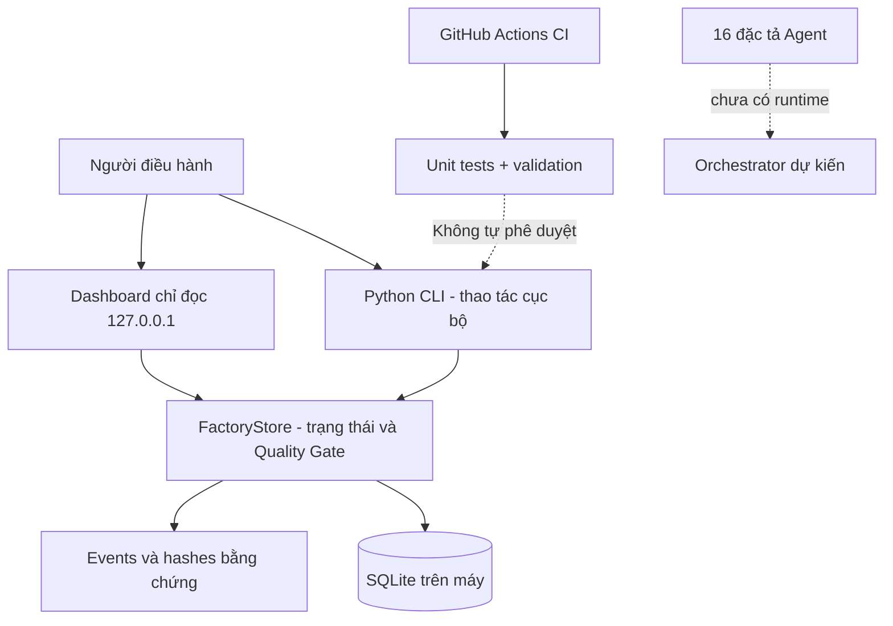

# Kiến trúc tham chiếu — v1.2.0

## Trạng thái thực tế

Hệ thống **chạy cục bộ** bằng Python stdlib và SQLite, không có Agent runtime,
không có API ghi dữ liệu qua mạng, không có đăng nhập/SSO/RBAC và không triển khai production.

## Quy trình nghiệp vụ

`Ý tưởng → SPEC → Thiết kế → Lập trình → Kiểm thử → Kiểm toán → Phê duyệt → Triển khai`

Mỗi giai đoạn có Quality Gate với chứng cứ tương ứng. CLI yêu cầu chứng cứ (loại + hash)
và tên người phê duyệt để ghi trạng thái; **chưa xác minh danh tính hay quyền phê duyệt**.

## Biên tin cậy

1. Người vận hành máy tính: tin cậy theo môi trường local, chưa có xác thực.
2. Dashboard HTTP: giao diện read-only, giới hạn loopback; không mở public.
3. GitHub: lưu code, tài liệu và CI, **không lưu database/secret hoặc bằng chứng thật**.
4. Các hệ thống bên ngoài (Codex, Work, AI Studio, Cloud, n8n): chỉ được mô tả, chưa kết nối runtime.
5. GitHub CI: cung cấp bằng chứng test trên commit, không thay thế người duyệt triển khai.

## Không nằm trong phiên bản này

Agent autonomous orchestration, queue worker, vector/knowledge graph, SSO/RBAC, tamper-evident audit
store, transactional deployment, monitoring production, backup/DR, quota & cost policies.

Xem `DOCUMENTATION/operating-guides/level-roadmap.md` để phát triển theo giai đoạn.
