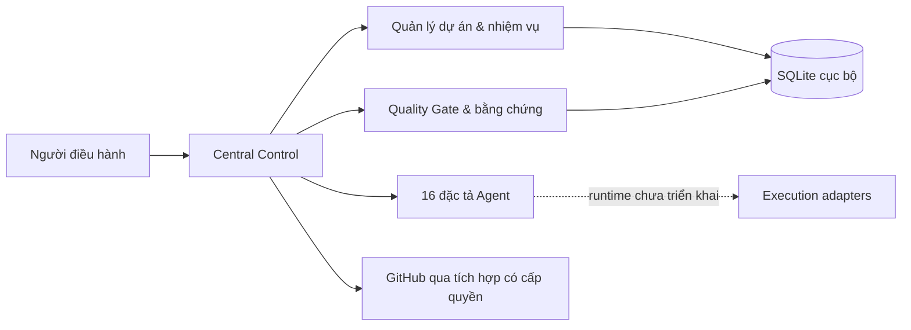

# AI SOFTWARE FACTORY — CENTRAL CONTROL

> **v1.2.0 • Local-first MVP • Python 3.11+**
>
> Hệ thống điều hành quy trình phát triển phần mềm theo `MASTER PROMPT 2026`.
> **16 vai trò Agent được định nghĩa**, nhưng **chưa có runtime Agent tự động**.

**Repository chính thức:** [lengocsang-1991/ai-software-factory-control](https://github.com/lengocsang-1991/ai-software-factory-control)

## Mục tiêu

Trung tâm quản lý nhiều dự án, có dấu vết bằng chứng, chuẩn hóa 8 giai đoạn và 8 Quality Gate.
Mọi hoạt động ghi trên GitHub, hợp nhất mã, triển khai production, thay đổi quyền hoặc phát sinh chi phí
phải có ủy quyền phù hợp. Không khẳng định Agent đang hoạt động khi chưa triển khai.



## Chạy nhanh

Không yêu cầu token GitHub hay thư viện Python bên thứ ba để vận hành **MVP cục bộ**.

```bash
python -m factory_control init
python -m factory_control project add --id DEMO-01 --name "Dự án demo" --owner "Operator"
python -m factory_control task add --id TASK-01 --project DEMO-01 --title "Product Brief" --owner "BA"
python -m factory_control task list --project DEMO-01
python -m factory_control gate list --project DEMO-01
python -m factory_control serve --port 8765
```

Dashboard **chỉ đọc**, tại <http://127.0.0.1:8765/> trên chính máy chạy chương trình.
Không sử dụng mạng public: phiên bản này chưa hỗ trợ đăng nhập và RBAC.

## Kiểm tra chất lượng

```bash
python scripts/validate_factory.py
python -m unittest discover -s tests -v
python scripts/check_github_target.py --authenticated-login lengocsang-1991 --repository lengocsang-1991/ai-software-factory-control
```

Bộ kiểm tra tài khoản chỉ so khớp dữ liệu đầu vào, **không thay thế xác thực thật với GitHub**.
CI GitHub Actions chạy kiểm tra cú pháp, cấu trúc và unit test khi có push/PR.

## Kiến trúc thư mục

| Đường dẫn | Chức năng |
|---|---|
| `factory_control/` | CLI, SQLite store, dashboard local chỉ đọc |
| `CONTROL/`, `WORKFLOWS/` | Trạng thái, nhiệm vụ, quy trình 8 giai đoạn |
| `AGENTS/` | 16 định nghĩa vai trò Agent; chưa có runtime |
| `QUALITY/`, `SECURITY/` | Quality Gate, bằng chứng, kiểm toán, chính sách |
| `PROJECTS/`, `REPORTS/`, `DOCUMENTATION/` | Mẫu đặc tả, báo cáo, tài liệu vận hành |
| `INTEGRATIONS/` | Phương án tích hợp; chỉ GitHub đã được xác minh quyền truy cập qua phiên ChatGPT |
| `tests/`, `scripts/`, `.github/` | Kiểm thử, quy tắc cộng tác và CI |

## Nguyên tắc vận hành và giới hạn

- `DONE` và `APPROVED` chỉ khi có bằng chứng; hệ thống không tự đánh giá tính đúng đắn nghiệp vụ của chứng cứ.
- Approval qua CLI chỉ ghi lời khai người vận hành, **chưa xác thực vai trò hoặc chữ ký số**.
- Bằng chứng được lưu bằng đường dẫn + SHA-256; không phải kho lưu bằng chứng chống sửa đổi.
- SQLite local, chưa có HA, SSO, hệ thống IAM, backup tập trung hoặc môi trường production.
- GitHub Actions kiểm thử mã nguồn; không đồng nghĩa code đã được triển khai hoặc Agent đang chạy.
- Không đưa dữ liệu người dùng, OTP, API key, token, chứng cứ thật hoặc `.factory-state/` lên repository public.

## Tài liệu dành cho cộng tác viên

- [Kiến trúc và biên tin cậy](DOCUMENTATION/architecture/ARCHITECTURE.md)
- [Hướng dẫn chạy](DOCUMENTATION/operating-guides/QUICKSTART.md)
- [Quy tắc đóng góp](CONTRIBUTING.md)
- [Chính sách bảo mật](SECURITY.md)
- [GitHub setup](INTEGRATIONS/github/SETUP.md)
- [Lộ trình](DOCUMENTATION/operating-guides/level-roadmap.md)
- [Changelog](DOCUMENTATION/release-notes/CHANGELOG.md)

**Bản phát hành này chỉ là nền tảng quản trị có kiểm thử, chưa phải AI Software Factory tự vận hành hoàn chỉnh.**
