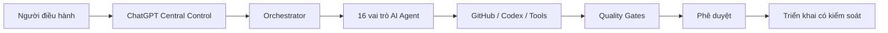

# AI SOFTWARE FACTORY — CENTRAL CONTROL

**Phiên bản thiết kế:** 1.2.0 · **Trạng thái GitHub:** Đang xây dựng · **Python:** 3.11+

Dự án phát triển nền tảng điều hành công việc phần mềm bằng AI theo mô hình **Human-in-the-loop**.

## Kiến trúc mục tiêu

## 8 giai đoạn

Ý tưởng → SPEC → Thiết kế → Lập trình → Kiểm thử → Kiểm toán → Phê duyệt → Triển khai.

## Điều đã có trong bản cục bộ

- CLI quản lý dự án, nhiệm vụ, trạng thái, bằng chứng, phê duyệt.
- SQLite cục bộ và dashboard đọc dữ liệu ở `127.0.0.1`.
- 16 đặc tả Agent, 8 Quality Gate và 15 bài kiểm thử cục bộ đã đạt.
- Bộ mã nguồn 1.2.0 hoàn chỉnh đang được chuẩn bị đồng bộ vào GitHub.

## Giới hạn quan trọng

**Đây chưa phải hệ thống AI Agent tự động hoạt động**, chưa có xác thực/RBAC hoặc triển khai production. Chưa xác minh kiểm thử GitHub Actions cho bản đầy đủ. Không ghi dữ liệu nhạy cảm hoặc credentials vào repository public.

## Làm việc trên GitHub

Phát triển trên nhánh `feat/*`, `fix/*`; mở Pull Request, chạy kiểm thử, review và được phê duyệt trước khi hợp nhất. Mọi thay đổi production cần phê duyệt riêng.

Xem [kiến trúc](docs/ARCHITECTURE.md), [bảo mật](SECURITY.md), [đóng góp](CONTRIBUTING.md), [lộ trình](docs/ROADMAP.md), [triển khai nguồn](docs/SOURCE-SYNC.md).
