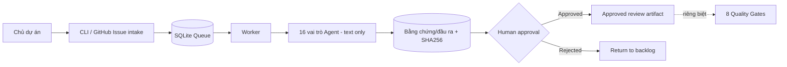

# AI SOFTWARE FACTORY — CENTRAL CONTROL

> **v1.3.1 · Local-first automation runtime · Python 3.11+**
>
> **Tình trạng:** MVP có 16 vai trò Agent tạo tài liệu đánh giá tuần tự khi kết nối provider; **chưa phải hệ thống tự triển khai phần mềm hoàn chỉnh.**

**GitHub:** [lengocsang-1991/ai-software-factory-control](https://github.com/lengocsang-1991/ai-software-factory-control)

## Thành phần đang hoạt động

- Quản lý dự án, nhiệm vụ và 8 Quality Gate bằng SQLite cục bộ.
- 16 vai trò AI Agent, 3 recipe phối hợp tạo báo cáo và bản dự thảo.
- Hàng đợi bền vững, worker nhận việc, ghi kết quả từng bước, retry lỗi, mã SHA-256 và yêu cầu phê duyệt trước khi công nhận kết quả.
- Chế độ mô phỏng (không tính phí, đầu ra dán nhãn `SIMULATED`) và chế độ AI thật qua OpenAI Responses API **hoặc Google Gemini Interactions API** khi có API key, model và xác nhận chi phí.
- Nhận có chọn lọc các GitHub Issue của chủ repo, có nhãn `factory:ready` — **chỉ đọc GitHub**, không tự thay đổi repo.
- Bảng điều khiển chỉ đọc tại `127.0.0.1` và GitHub Actions kiểm thử với Python 3.11/3.12/3.13.



## Khởi động thử cục bộ

```bash
python -m factory_control init
python -m factory_control project add --id DEMO-01 --name "Demo" --owner operator --repository lengocsang-1991/ai-software-factory-control
python -m factory_control automation enqueue --project DEMO-01 --objective "Lập SRS sản phẩm thử nghiệm" --recipe discovery
python -m factory_control worker
python -m factory_control automation list --project DEMO-01
```

**Đây là mô phỏng**, chỉ dùng để kiểm tra điều phối. Để dùng API thật, tham khảo [Hướng dẫn Agent Automation](docs/AUTOMATION.md), cấu hình khóa từ secret manager, chạy worker với `--provider openai --confirm-cost`. Không đưa khóa vào repo/chat.

## Kiểm tra

```bash
python scripts/validate_factory.py
python scripts/check_github_target.py --authenticated-login lengocsang-1991 --repository lengocsang-1991/ai-software-factory-control
python -m unittest discover -s tests -v
```

## Giới hạn

Agent không có quyền gọi shell, chỉnh sửa mã nguồn, tạo/merge PR hoặc deploy. Phê duyệt local chưa được xác thực danh tính. Worker chưa được cài lên máy chủ chạy liên tục. Cần tích hợp thực thi mã có sandbox, IAM/RBAC, backup và kiểm tra bảo mật trước khi được coi là production-ready.

Xem [Kiến trúc](docs/ARCHITECTURE.md), [Vận hành tự động](docs/AUTOMATION.md), [Bảo mật](SECURITY.md), [Quy trình cộng tác](CONTRIBUTING.md), [Lộ trình](docs/ROADMAP.md).
